# Motion Studio — visual review gallery\n\nActual first-section browser screenshots from the offline HTML build.\nEach template was captured at desktop (1440×900) and mobile (390×844).\nScreenshots are raw CI evidence, not approved visual design.\n\n| Template | Desktop | Mobile |\n|---|---|---|\n| Editorial Portfolio | 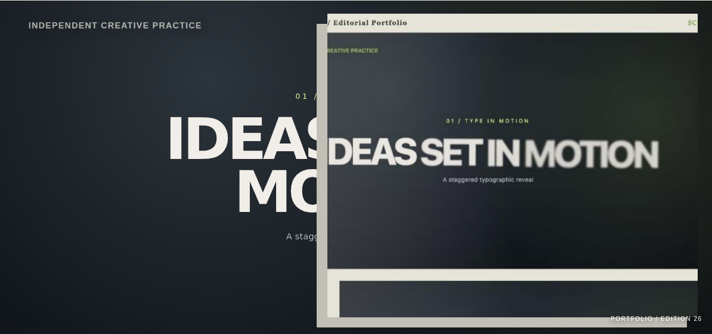 | 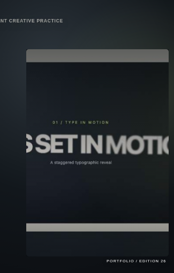 |\n| 3D Product Experience | 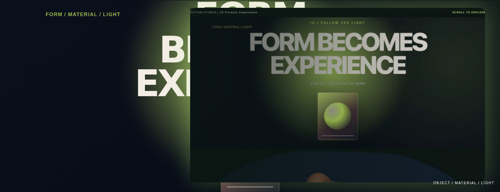 | 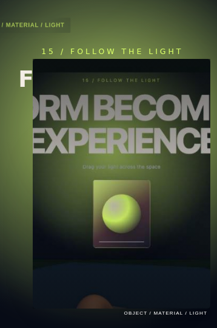 |\n| Cinematic Journey | 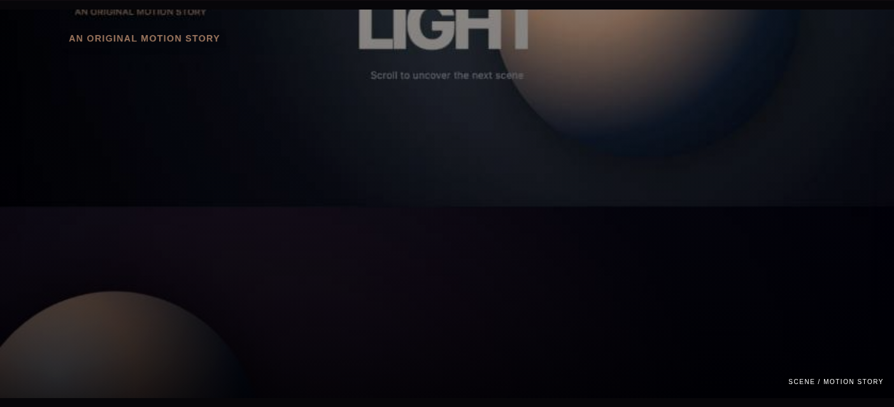 | 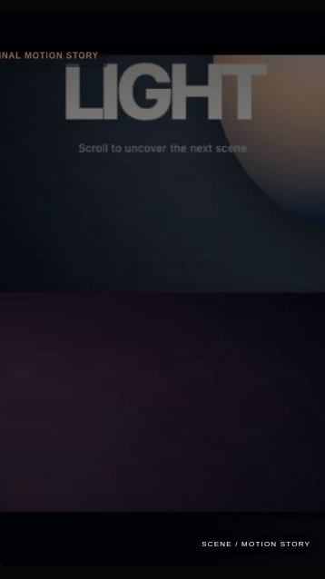 |\n| Architecture Studio | 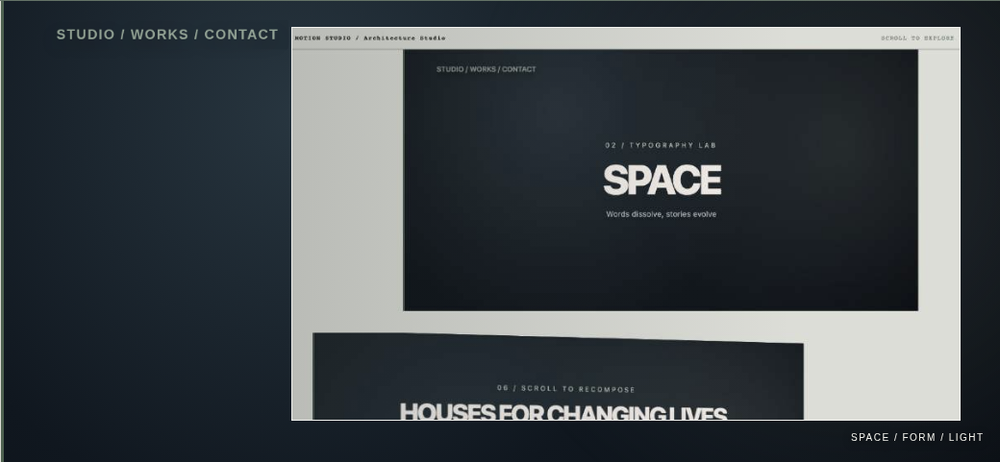 | 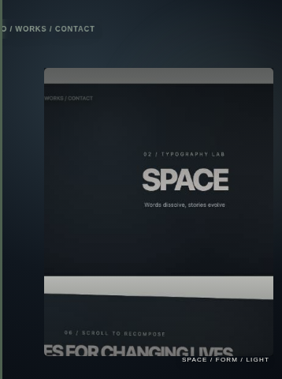 |\n| Creative Agency | 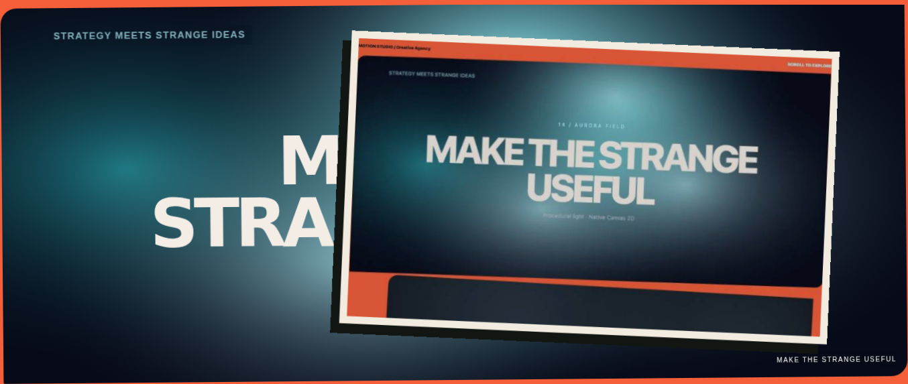 | 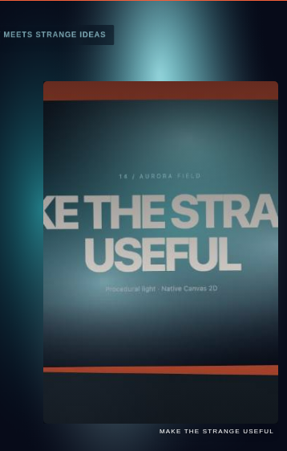 |\n| Fashion Lookbook | 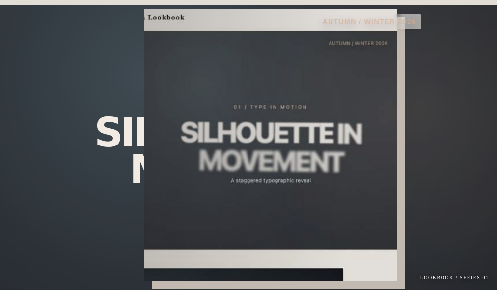 | 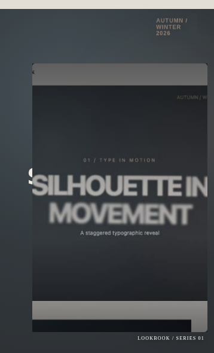 |\n| Interactive Gallery | 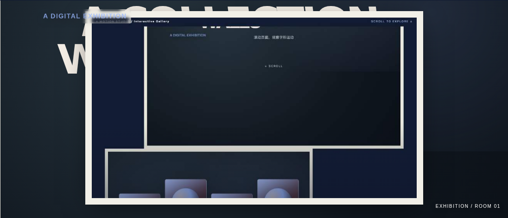 | 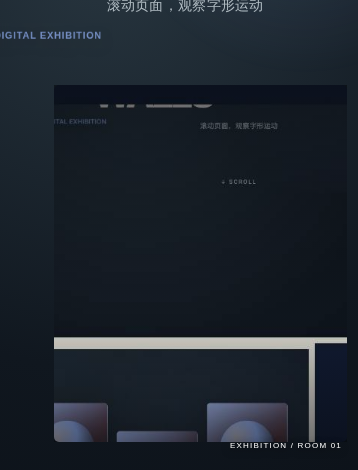 |\n| Modern SaaS | 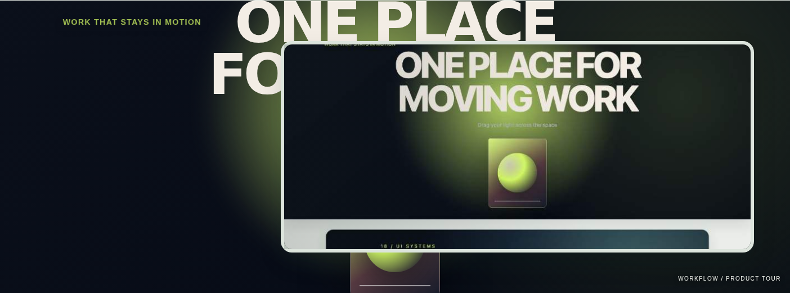 | 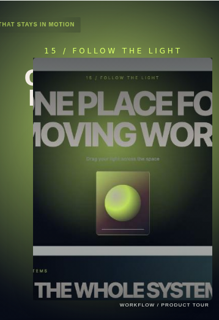 |\n\n## Review gates\n\n- Typography, photo crop and subject matter\n- Content hierarchy and readability\n- Motion quality while scrolling and interacting (not judged by still screenshots)\n- Template differentiation and reference-site visual quality\n- Source-media licensing: not yet verified\n\nScreenshots were generated by the browser visual-audit suite.\nSee `../VISUAL_AUDIT_REPORT.md` for geometry results and limitations.\n