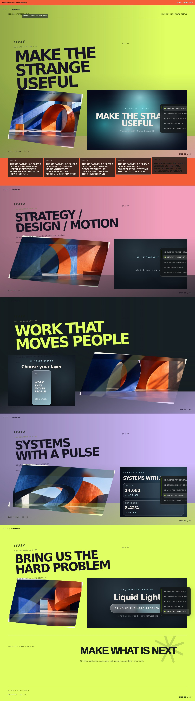
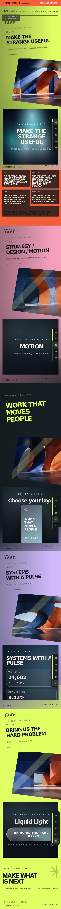
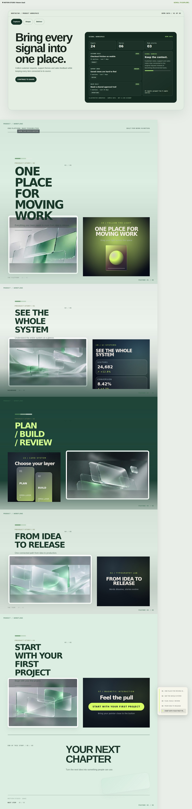
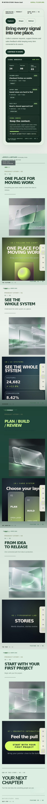
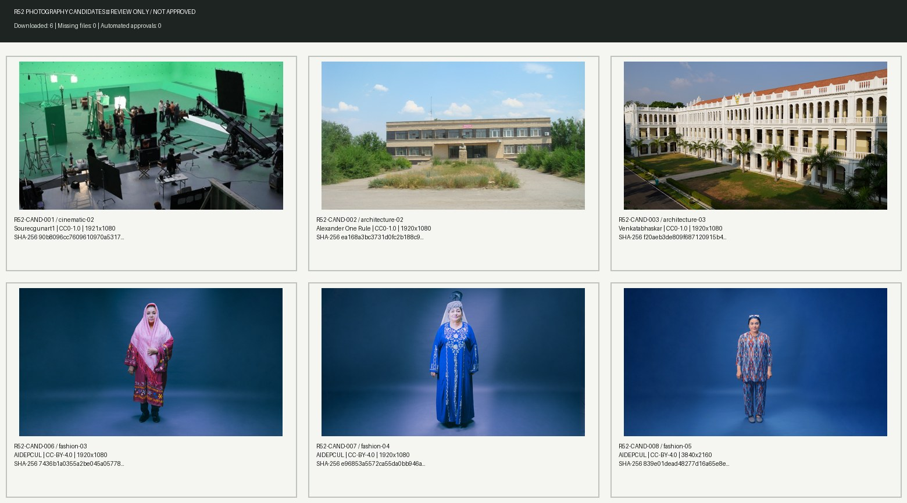
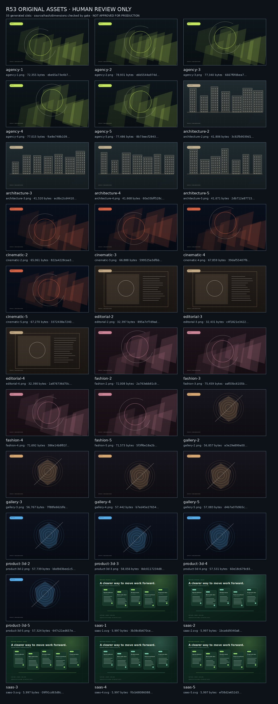

# Motion Studio R43–R55 exact-SHA evidence

Candidate SHA: 844026ba40e121dd2213696599dd9f62787c29d6

Overall HOLD. This is a review archive, not visual, legal, device, merge or production approval.

| Gate | Result |
|---|---|
| R50 | PASS_BROWSER_FUNCTIONALITY_ONLY |
| R56 | PASS |
| R52 | HOLD — 0/15 accepted |
| R53 | HOLD — 0/33 accepted; 0/33 referenced |
| R47 | {"chromium": "NOT_AVAILABLE", "firefox": "NOT_AVAILABLE", "webkit": "NOT_AVAILABLE"} |
| E2E | {"chromium": "NOT_AVAILABLE", "firefox": "NOT_AVAILABLE", "webkit": "NOT_AVAILABLE"} |
| R48 | PASS_CANDIDATE_ONLY |
| R54 | HOLD — physical device evidence required |
| R55 | HOLD — no production deployment authorized |

## Reports
- [R50 browser report](reports/R50_HTML_BROWSER_ACCEPTANCE.json)
- [R56 reference capture report](reports/R56_REFERENCE_SCREENSHOTS.json)
- [R52 itemized rights report](reports/R52_PHOTO_RIGHTS_REPORT.json)
- [R52 discovery](reports/R52_DISCOVERY_REPORT.json)
- [R52 download evidence](reports/R52_DOWNLOAD_REPORT.json)
- [R53 asset report](reports/R53_33_ASSET_REPORT.json)
- [R53 register](reports/R53_PRODUCTION_ASSET_REGISTER.json)
- [R48 candidate gate](reports/R48_CANDIDATE_GATE.json)
- [Human action list](reports/HUMAN_ACTION_REQUIRED.md)

## Agency and SaaS full-page captures

### Agency desktop

### Agency mobile

### Saas desktop

### Saas mobile

## R52 candidates — review only

## R53 originals — review only

## Human gates
- Visual review and explicit Agency/SaaS approval.
- Per-image R52 source, exact license, attribution, suitability and commercial compatibility review.
- All 33 R53 assets must be visually approved and referenced by live export pages.
- R54 physical iOS/Android device checks; R55 only after authorization and exact-SHA HTTPS verification.
- PR #4 remains Draft and unmerged.
